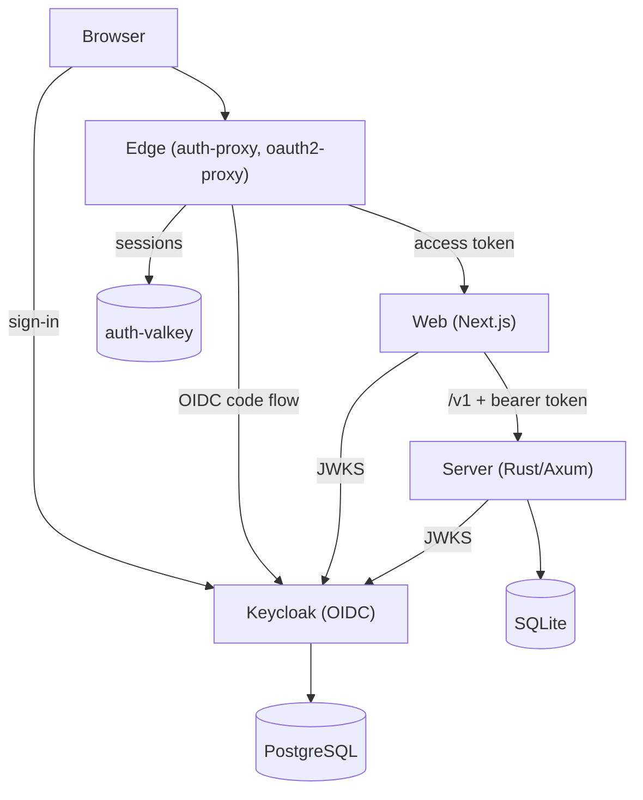

# Keasy

Federated workspace management platform — connect data, build catalogs, share datasets.

## Quick start

Needs Docker with Compose v2.20+ and ~8 GB RAM (Keycloak + the first Rust compile).

```bash
make dev
```

`make dev` brings everything up and returns when the web answers: open
[http://acme.localhost:3000](http://acme.localhost:3000) and log in at Keycloak. The first one takes
a while — it compiles the server's dependencies and the web's first pages — and later ones reuse the
cached volumes. The platform's services, identity and the session's edge, are kanzo-ui's, included by
URL at the release `web/package.json` names; nothing is checked out.

Every dev value is a literal in `compose.yaml` and `compose.override.yaml`, and a local `.env`
overrides any of them. Anything past `make dev` is plain
`docker compose`, which reads the development files on its own: `docker compose logs -f web`,
`docker compose restart acme-server`, `docker compose exec web sh`, `docker compose down`.

| What | Where |
|------|-------|
| App (the edge, then the web; `/api/v1`) | [http://acme.localhost:3000](http://acme.localhost:3000) — one web, each organization at its subdomain |
| Keycloak | [http://localhost:8080](http://localhost:8080) (admin `admin` / `admin`) |
| API, for curl | `http://localhost:8081` |

### AI in development

The model runs in the browser, on WebGPU — Chrome or Edge, Safari 26, Firefox on Windows — through
WebLLM. The browser downloads it in the background when a graph or the assistant opens, about
2.3 GB once, and keeps it; nothing about a question leaves the browser, and no server holds a key.
It comes from where WebLLM's own arrangement has it: the public MLC weights from Hugging Face and
the compiled library from GitHub, both at pinned revisions and the small files checked against
their hashes, as `web/public/models/app-config.json` lists them. Nothing to download or run
for it here, but the browser needs egress to those hosts. In a browser without WebGPU, Ask and
the assistant say so (`llm/unavailable`); everything else works.

## Dev accounts

The platform's seed users (kanzo-ui `services/auth/seed`), all with password `kanzo-dev-password`.
This instance serves the `acme` organization. A role comes from the organization group
the user is in, which the seed maps onto keasy's roles (`configs.keasy-roles` in `infra/dev/platform.yaml`):

| User | acme (this instance) | globex | What it shows |
|------|----------------------|--------|---------------|
| `ana` | admin (*Admins*) | reader (*Readers*) | everything; the switcher between two organizations |
| `bruno` | editor (*Data team*) | — | builds graphs, connections and secrets; changes what he made |
| `eva` | reader (*Analysts*) | — | reads graphs, outputs and connections; creates nothing |
| `fede` | member, no group | — | signed in, no role here: the forbidden page |
| `carla` | — | admin (*Platform*) | a member of another organization only: no role here |
| `dan` | — | — | no organization at all |

Roles nest: reader ⊂ editor ⊂ admin, composites in keasy's declaration (`compose.yaml`,
`x-application`), so a token carries the expanded set. Prod has no seed: people are invited into their organization from Keycloak,
and its admin maps keasy's roles onto the organization's groups.

## Dev data

`make dev` also brings up an S3 store, dev-only: [SeaweedFS](https://github.com/seaweedfs/seaweedfs),
configured by `infra/dev/seaweedfs/` (its keys in `s3.json`, and in `iam.json` the role
the server assumes to vend a credential scoped to one prefix). It has no console.

| What | Where |
|------|-------|
| S3 API (and STS) | `http://s3.localhost:9000` (and `http://localhost:9000`) |
| Credentials | `keasy-admin` / `keasy-admin-secret` |
| Bucket | `keasy-dev`, seeded from `infra/dev/examples/` on every `up` |

The dev graph is the [LDBC Social Network Benchmark](https://ldbcouncil.org/benchmarks/snb/)
at scale factor 0.1 — the official Interactive v1 `CsvCompositeMergeForeign` archive
(about 17 MB compressed, 59 MB of CSV: 1.5k people, 136k posts, 151k comments). It is
not in git; fetch it once, before `make dev`:

```bash
make seed   # downloads, checks the SHA-256s, unpacks into infra/dev/examples/<name>/data/
```

The same `make seed` fetches a second, geographic graph: [OpenFlights](https://openflights.org/data)
airports and routes, pinned to one upstream commit and its SHA-256s, and cut down to the 3,218
airports some direct route touches and the 36,906 directed routes between them (700 KB of CSV, needs
`python3`). Every airport carries numeric `lat` and `long` in WGS 84 degrees, so Discover's Map
placement (x = `long`, y = `lat`) draws it as a map. The data is © OpenFlights under the
[ODbL](https://opendatacommons.org/licenses/odbl/1-0/) — `infra/dev/examples/openflights/data/NOTICE` is the
attribution, and it travels to the bucket with the files. It is derived on your machine and not
committed: the subset's own digest is pinned, so every machine derives the same bytes.

And a third, whose time is on a relation: the [Nobel laureates](https://www.nobelprize.org/about/developer-zone-2/)
and every prize awarded to 2025, from nobelprize.org's API (CC0), derived into six JSON files
(470 KB, needs `python3`). Each prize a laureate won is a vertex between the laureate and the
category — the API's own Linked Data vocabulary models it so, as `nobel:LaureateAward` — and it
carries its year as an `xsd:gYear`, so a timeline over it plays the prizes forward and greys the
edges into the years it leaves out. The API is live, so the download is not pinned and the
derivation is: prizes to 2025, every list sorted, the digests of the six files; a correction
upstream fails `make seed` rather than changing the graph. `infra/dev/examples/nobel/data/NOTICE`
names the source.

Without them the bucket holds the shapes alone and `s3-init` says to run `make seed`.
The failure scenarios do not need it: `s3-init` also mirrors the suite's own
fixtures (`e2e/fixtures/`, a small shop: people, orders and `shop.shex`) to `e2e/`,
and the suite declares its connections over them (**E2E source**, **E2E shapes**) as
it signs in. The smoke (`e2e/smoke/`) does: it runs each example's program over its seed
and drives Discovery through them, so `make e2e` fetches them first, as CI does.

Each example is one folder under `infra/dev/examples/<name>/`: `fetch.sh` (what `make seed` runs
for it), `shapes.shex`, `mapping.fossil` and the gitignored `data/` it fetches. In the bucket it is
`examples/<name>/data/` and `examples/<name>/shapes/`. At boot the instance declares, over them, a
data source and a vocabulary connection per example — **LDBC SNB** and **LDBC SNB shapes**,
**OpenFlights** and **OpenFlights shapes**, **Nobel laureates**
and **Nobel laureates shapes** — and the sink, **Workspace output** (`output/`). Access is proved
before each connection row is written, and an existing sink is never overwritten. Each example's
program reads its own two connections; paste one into the studio to map its graph into `output/`:

| Program | Graph |
|---------|-------|
| `infra/dev/examples/snb/mapping.fossil` | LDBC SNB SF0.1 onto its `shapes.shex` |
| `infra/dev/examples/openflights/mapping.fossil` | OpenFlights onto its `shapes.shex`: 3,218 `Airport` vertices with `lat`/`long`, 36,906 `routeTo` edges |
| `infra/dev/examples/nobel/mapping.fossil` | The Nobel laureates onto its `shapes.shex`: 1,018 `Laureate`, 1,026 `LaureateAward` with their year as `xsd:gYear`, 6 `Category`, 379 `University`, 86 `Country` |

`infra/dev/examples/openflights/rules.ttl` is rules for the OpenFlights graph: a SHACL shapes graph
to drop on the rules' badge in Discover's filter bar. Most airports conform; 44 fail it (no IATA code, or
an ICAO field that is not a four-letter ICAO code), and two kinds draw a warning: 29 with no time
zone and 218 above 4,000 ft, where takeoff performance is limited.

`s3.localhost` is load-bearing: Docker's DNS answers it inside the compose network
and `*.localhost` is loopback on the host, so the endpoint the server is given
(`AWS_ENDPOINT_URL_S3`, and the vended credential names) works from both sides. The issuer is `http://localhost:8080/realms/kanzo`, the one the
browser sees; the server and the web fetch its keys at `http://keycloak:8080`
(`KEASY_OIDC_INTERNAL_BASE_URL`, `KEASY_OIDC_JWKS_URL`).

## Architecture



The session is the platform's edge. **auth-proxy** (kanzo-ui's oauth2-proxy, on :3000) is the
OIDC relying party in front of the web: it holds keasy's confidential client, signs the person in,
keeps the session in its own Valkey, renews it, and signs out under `/api/auth`, forwarding the
access token on every request. The **web** holds no secret and no session: it verifies that token
(`@kanzo-tech/auth/next`) and hands the person to the page. **One web serves every organization** —
Keycloak's Organizations model, one `keasy` client for all of them: the organization is the host's
subdomain (`<alias>.<KEASY_BASE_DOMAIN>`), and the token carries every membership (which is what the
workspace switcher lists) and names `keasy-api` in `aud`. The **server** is per organization, and so
is its data: it is a resource server that validates the bearer token against the realm's JWKS
(`iss`, `aud`, `exp`, `azp`, signature), reads the roles its own organization grants, and holds no
client secret, no session and no cookie. The web forwards `/api/v1` with the same token to the
server of the organization the request addresses (`KEASY_API_URL`, with `{tenant}` standing for its
alias), and refuses one the token does not name.

Mappings run in the browser (DuckDB-WASM + `@fossil-lang/*`), and so does source
introspection; the server hosts connections, vends credentials scoped to one prefix, graphs and the catalog,
and never reads a data file. Every graph names a sink as its destination. The work
is shared: everyone in the workspace reads every graph, every editor runs it, and its
owner or an admin changes it (roles `reader ⊂ editor ⊂ admin`, from the Keycloak
organization the instance serves; the matrix is `docs/design/permissions.md`).

The model runs in the browser too: `localModel` from `@kanzo-tech/llm/local`, WebLLM on
WebGPU in a worker of its own, the models this origin's `/models/app-config.json` lists
(`web/public/models/`; the weights themselves come from Hugging Face, once). No call
leaves the page, so there is nothing to forward, no model key and no budget to keep.

A **credential** (S3 or Azure) is who keasy is when it reaches a store; a
**connection** puts one to use (a storage prefix — a source or the one sink). Both
are validated on every write,
and a credential in use cannot be deleted. `KEASY_BOOTSTRAP_FILE` declares them at
boot in the API's own request format (dev: `infra/dev/bootstrap.json`).

An instance's look is declared, not edited: `KEASY_BRANDING_FILE` names a YAML
file holding exactly what kanzo-ui's theme generator exports (`branding:` with
`theme_css`, `families`, `default`, `lock`, and optionally `logo`), validated at
boot and served publicly at `GET /v1/branding`. Without it every shipped theme is
offered. Example: `infra/dev/branding.example.yml`.

Stored credentials are sealed with `KEASY_SECRET_KEY`: 32 random bytes in base64
(`openssl rand -base64 32`). The server refuses to start without one, and refuses
a database whose schema is not the one it ships — there are no migrations: a schema
change is the database dropped and created again, so wipe the volume (`make clean`, or
`docker compose down -v`) and start the stack again. The latest such change is the
`conversations` table (the assistant's conversations, and each graph's own).

## Development

| Target | What it does |
|--------|--------------|
| `make dev` | Start dev and wait until the web answers; again only after dep or Dockerfile changes (code hot-reloads) |
| `make seed` | Fetch the dev graphs, for the next `make dev` to upload |
| `make clean` | Remove containers, volumes (Keycloak, the realm's state, data) and images |
| `make e2e` | The failure scenarios and the smoke over the dev seeds (`e2e/`, Playwright) against the stack, as CI; main checkout only, as Keycloak admits :3000 alone |
| `make demo` | List the product demos; `DEMO=<name>` or `DEMO=all` records them (see [Demos](#demos)) |
| `make api` | Regenerate the API contract ([API contract](#api-contract)) |

Everything else is `docker compose`, which reads `compose.yaml` and `compose.override.yaml` on its
own. The platform's release is the tag in the `include:` of `compose.override.yaml`, the
`@kanzo-tech/ui` version `web/package.json` names; infra-ci fails when the two differ;
the Rust toolchain is pinned once, in `server/rust-toolchain.toml`. Images are published to GHCR by
`.github/workflows/images.yml` on `v*` tags, after the server and web CI pass. There is no deployment yet:
what one will need to know is in [`docs/design/permissions.md`](docs/design/permissions.md#when-a-deployment-exists)
and [`docs/design/assistant.md`](docs/design/assistant.md).

## Demos

Product demos are Playwright scripts in `e2e/demos/` that record a story and check each step of it, against
the stack `make dev` and `make seed` bring up on :3000 (main checkout only, as for `make e2e`).

```sh
make demo                          # list them: name and what each shows
make demo DEMO=snb-explore         # record one, light and dark
make demo DEMO=all THEME=dark      # every demo, one side
```

Each lands in `e2e/demos/out/` as `<demo>-<theme>.mp4` (H.264, 1600×900), `<demo>-<theme>.png`
(the poster) and `<demo>-<theme>.chapters.json` (each subtitle and when it shows), gitignored.
The viewport is 1600×900 so the app's text reads once the video sits in a page. It needs `ffmpeg` on PATH (`brew install ffmpeg`), which turns
Playwright's frames into the MP4. The demos project runs Chromium on the GPU (Metal on a Mac,
`playwright.config.ts`), which the Graph view needs: in software it paints at a frame or two a second.

`make demo` touches no container for a graph demo: Next's dev indicator and React Query's devtools
are hidden in the recording's browser. A demo that asks the model (`nobel-ask`) asks everyone's, in
the recording's browser on its GPU (WebGPU): it waits for the model to load before the take, and the
figures on screen are the graph's, read under the page's filter.

**Adding a demo** is a file `e2e/demos/<name>.demo.ts` calling `demo(name, description, { arrange,
steps })` from `e2e/demos/record/`, transcribed from its table in `e2e/demos/STORYBOARD.md`; `make demo`
lists it from that title. `arrange` gets the page ready off camera (`seedGraph` from
`e2e/support/seeds.ts`, builds a dev example's graph) and gets the page and its
`@kanzo-tech/testing` environment, made before the page loads. Each step is a **subtitle**, an
**action** — a call on keasy's page objects (`e2e/support/app/`) or the library's harnesses, brushes
and lassos in data — and a **check**, so a take whose page did something else fails rather than
recording it; `poster: true` takes the still after a step. No title cards. The subtitle leads its step
and stays up for its reading time (`hold`, the only wait on a clock, and the viewer's). The cursor is the
page's own (`e2e/demos/record/cursor.ts`): an overlay injected into the recording's browser that
follows the real pointer events, glides to each target before the action lands and rings where a
button goes down; while a demo records, every click, hover, fill (typed) and `page.mouse` gesture waits
out that glide, so the cursor arrives before the page answers. `snb-explore.demo.ts` is the worked
example.

## API contract

The wire types live next to what they describe in `server/src`; each route
module's `router()` is both its routes and their spec. `api/` (`@keasy/api`) holds
the committed `openapi.json`, the types generated from it and the client the web
uses. `server/tests/api/openapi.rs` is a golden test of `openapi.json`, so
`cargo test` (and CI) fails when it is stale.

```bash
make api   # UPDATE_EXPECT=1 cargo test --test api openapi, then pnpm generate
```

## Layout

```
api/                @keasy/api: the committed spec, its generated types and the client
e2e/                @keasy/e2e: one Playwright test per failure scenario, the smoke over the dev seeds, its fixtures, and the `faults` profile's servers
compose.yaml        keasy as it runs anywhere: the web, its sessions, its declaration in the realm
compose.server.yaml one organization's server, which compose.override.yaml extends
compose.override.yaml  development: the platform in its dev shape, builds, the S3 store, the faults
infra/dev/          development's organization, secrets, roles, S3 config and seed examples
server/             Rust API (Dockerfile = release, Dockerfile.dev = cargo-watch)
  src/main.rs       configures from the environment and serves
  src/startup.rs    Application, AppState, the router and the spec it publishes
  src/routes/       one file per resource: handlers with their bodies
  src/domain/       the records and parse-don't-validate types
  src/{credentials,connections,graphs}/  persistence and shared behaviour
  tests/api/        black-box HTTP tests through spawn_app, and the spec golden
web/                Next.js app and the API forward (Dockerfile = release, Dockerfile.dev = HMR)
```
