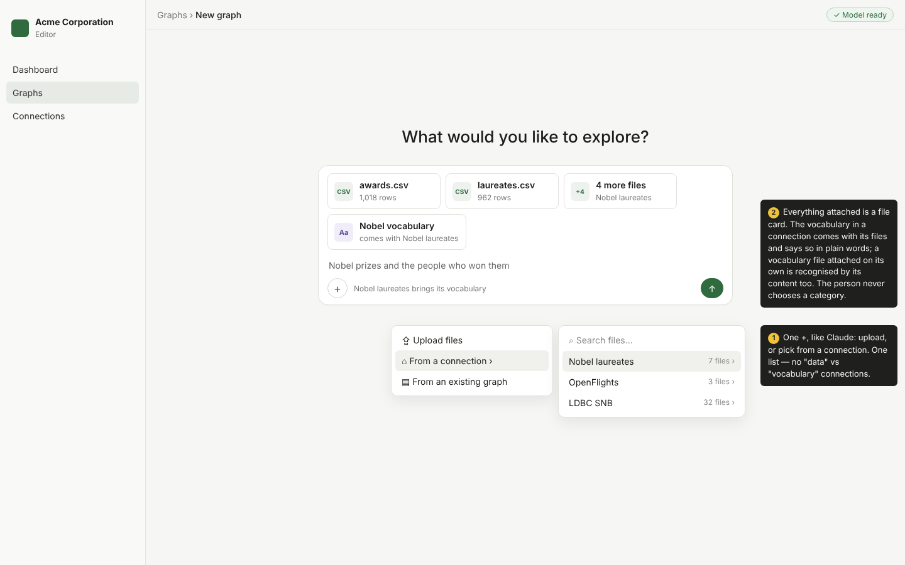
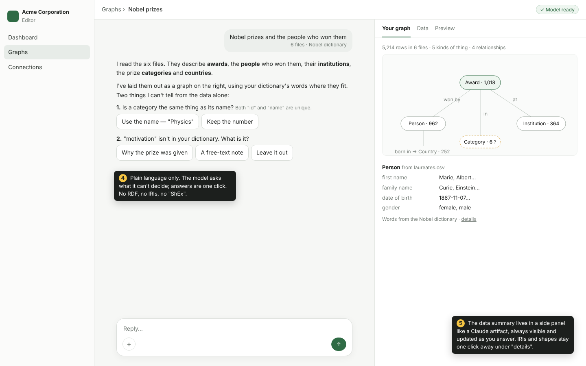
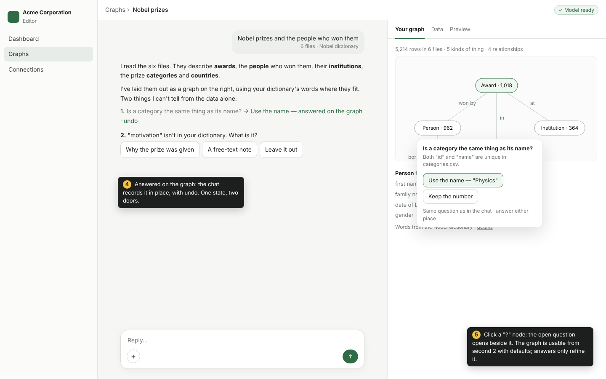
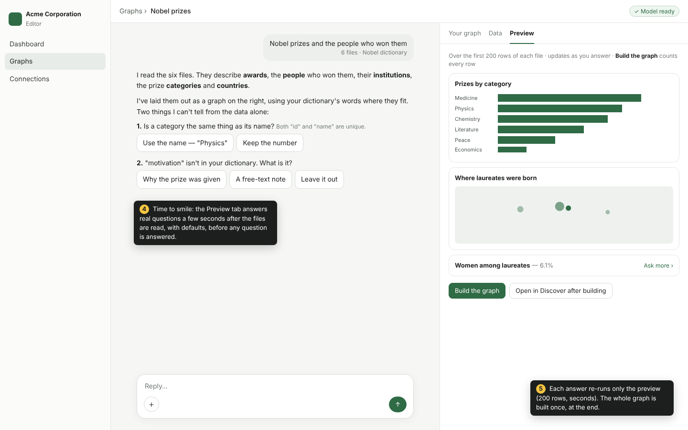

# The assistant, and time to smile

Status: a direction. Built: the model in the page, served from keasy's own origin and preloaded with
intent; the guided chat and its three Tasks, `model`, `mapping` and `requirements`, over fossil's
profile (below); the conversation kept, the preview run in memory, and the build. **Decided
2026-10-20, not built:** [a conversation beside its graph](#a-conversation-beside-its-graph) — one **+**
and file cards, a dataset's vocabulary as a file beside it, a panel with *Your graph*, *Data* and
*Preview*, questions marked on the graph and answered in the conversation, a shell of its own, the schema and the program drawn on one diagram with React Flow and ELK — and [`model`'s structure taken from the profile](#model--structure-from-the-profile-names-from-the-model).
They replace the single thread of 2026-10-14 and its checkpoints, each where it is described. The pattern this rests on — a *Task*: a small model in the browser fills a small artefact under a JSON Schema, a deterministic oracle checks it, a bounded loop repairs
it or asks the person — and its API, its model and its decisions are kanzo-ui's, on
[Tasks](https://kanzo-tech.github.io/ui/docs/design/tasks). fossil's half — `fossil-profile` in place
of introspect, and a mapping spec from which Fossil is emitted — is on
[Profile, and the mapping a model proposes](https://kanzo-tech.github.io/fossil-lang/docs/design/profile).
This page is keasy's part: the assistant's conversation, the metric they are built for, and what changes
in keasy's own configuration and runtime. What of it moves into kanzo-ui and fossil once they release it — the
conversation's keeping, the Tasks' guesses and the evaluation set — is said in each section below, and the order is on [cleanup](cleanup.md).

## The problem

One call writing a whole program from a prose description of Fossil does not work with a small
model: it does not see the shapes, it guesses keys and edges, the studio's checker reports after the
fact, and nothing repairs. "Done"
means "it compiles". A call through a gateway would send the question out of the
browser, and the AI would be down whenever the gateway is: the model runs in the page (below).

## Time to smile

**The metric is the time from the first file connected to the first answer of Ask in Discover.** The
smile is on the first answer about one's own data, not on "graph created". Design targets, not
measurements: the profile in about 5 s, *what is in your data* in about 20 s, the first answer under
60 s; the full graph builds in the background, and the model download is preloaded when the
assistant opens.

It is measured in three places, and nothing leaves the browser for any of them: in CI, where
Playwright times the whole path over the four examples (median and p90 per version); in user tests,
where the tester exports their local journal by hand; and in the app, which can show it to whoever
uses it.

## A guided chat, not a wizard

The person using the assistant knows their data, not RDF or ShEx. ShEx is still how the ontology is
made operational, but it sits underneath, as SQL sits under a tile.

The assistant is **a conversation built of talk, questions and decisions**, in one centred column, drawn
with kanzo-ui's chat parts (`Conversation`, `Message`) as Ask's panel is.

**The person's replies are choices, chips or questions — never free-form instructions.** What they send
or write is drawn as their message (the files with *what is it about?*, a question); a choice made on a
decision's options is not said again as a reply — it stays selected where it was made, which is where
it is changed, by picking another. A thing said twice reads as two things.

**The composer's field is always on, and what is typed in it is a question about the data** —
*Ask anything about your data*. Before the first message it is the optional *what is it about?*,
sent with the files; after it, every line is a question: Ask answers it in the *Preview* tab over the
first 200 rows, and it is kept as one of the questions the graph must answer
([competency questions](#what-is-kanzo-uis-and-what-is-keasys)). Typed text that is not a question —
*call Laureate Person* — is not read as an instruction: the reply says where that is changed, a
link to the thing on the graph. **A checkpoint says when the conversation turns to the data.** Once the *Preview* has its first
answers, a divider crosses the thread — *Your data is ready to ask · first 200 rows* — and the
field's placeholder becomes *Ask anything about your data*. Above it the assistant is reading and
proposing; below it the person is asking. A question typed before it is kept and answered as the
divider lands, so the field never refuses. It is a marker in the thread, not a state to go back to:
the checkpoints of 2026-10-14, points to cut the thread back to, stay gone
([below](#questions-in-the-conversation-marked-on-the-graph)). Decided 2026-10-20 over a field that was off except while the thread
waited on a question, which in a conversation drawn as Claude's reads as broken. *What would reverse
it:* people who type instructions more often than questions — then the reply that points to the
graph is the wrong door, and an instruction is a Task's input, under its schema, like the rest.

**A default taken is said once, with one door to its options: *I assumed: id · Change*.** The line is
what was taken, and *Change* opens the question under it; the options are not drawn beside it. This
reverses the rule that said an assumption's options are always in place, with no *Change*, because
they were a second door to the options of the decision it assumed for, and nobody read them as one —
the artifact the thread was designed in (*Asistente en un hilo*) draws the line alone, and a grid of
radios under every assumption turned a line into a form. A decision with no safe answer is the
opposite case and keeps its options in the open, because the build waits on it. *What would reverse
it:* people who change an assumption and do not find *Change* — a line that reads as plain text —
then the options are in place again, and the line is their heading.
*What would reverse the whole rule:* a transcript read away from its options — exported, or shown
where they cannot be drawn — where the choice has to be said in words; then a decision answered is a
reply again.

## A conversation beside its graph

**Decided 2026-10-20, not built.** The assistant is two things side by side, as Claude is: **the
conversation on the left**, and **the graph it is making on the right**, in a panel the size of an
artifact's. It replaces the single thread decided on 2026-10-14, which put every result — what is in
the data, the preview — in the thread under the step that made it, after ChatGPT's data analysis and
Julius. That rule named its own reversal: *a preview unreadable inside the thread, or a decision and
the answers it changed screens apart, sends the assistant back to a split layout*. The owner's review
of the built thread (2026-10-20) is that evidence: the summary of the files scrolled away under the
first message, the decisions and what they changed were screens apart, and the composer's two rows of
pills read as clutter.

**The person never needs to know RDF, ShEx, SHACL or any particular vocabulary.** Every word the
assistant shows is the person's or the data's: *Award · 1,018*, *won by*, *date of birth*. IRIs,
shapes and the program are one click away, under *details* and **Open in the editor**, for whoever
wants them, and nowhere else. This was already the rule for *what's in your data*; it now holds for
the whole assistant, the vocabularies included.

### One +, as Claude's

The composer has one **+**, as Claude's does: *Upload files*, *From a connection* — the connections as
one list, each opening to its files with a search over them — and *From an existing graph*. What is
picked is drawn as **file cards** above the field: *awards.csv · 1,018 rows*, *+4 more files · Nobel
laureates*. There is no row of pills per connection and no split between data and vocabularies. The
first message sends the cards and the sentence the person typed, together, as before.

What goes: the pills above the field (one per readable connection, each with a menu of checkable
files), and the *Data* / *Vocabularies* rows a first sketch of this page drew. Two kinds of pill asked
the person to know which of their files were data and which were a vocabulary — a question about the
technology, not about their data. *What would reverse it:* people who cannot find their files behind a
**+**, in a user test, where a pill per connection showed them — then the connections come back as
pills, still one row, and the cards stay.

### A dataset's vocabulary is a file beside it

A vocabulary — the kinds of thing a graph should have, their fields and the words for them, a ShEx,
SHACL or OWL file underneath — is not the workspace's, set up once by an admin: it is **a dataset's**.
The Nobel vocabulary goes with the Nobel files, and another dataset in the same workspace has its own
or none. So it is **a file like any other, recognised by its content**, and nothing else marks it:

- **Picking files from a connection brings the vocabulary files that connection holds**, as one card
  of their own, *Nobel vocabulary · comes with Nobel laureates*, which the person may remove. The data
  and its vocabulary are one connection: `s3://…/nobel/` holds `data/` and `shapes.shex`.
- **A vocabulary file attached on its own** — uploaded, or picked from any connection — is recognised
  the same way and used for the files beside it. This is how one vocabulary serves several datasets:
  it is picked where it lives. The card says *vocabulary*; the person never says so.
- **A graph built before keeps its words**: *From an existing graph* brings its vocabulary with it.

What the vocabulary does is unchanged from the person's side: the assistant uses its words where they
fit (*Person*, *date of birth*) and asks, in plain words, about what is not in it (*"motivation" isn't
in your vocabulary. What is it?*).

**What goes: the Vocabulary kind of connection** (`ConnectionKind::Vocab`, the *Vocabulary* tab on
Connections, the studio's *vocabulary* label on a connection) — a second way of saying what a file's
content already says. A connection is a storage location and nothing more; the studio reads a file as
a vocabulary or as data by its format, as the **+** does. This was option (a) of 2026-10-20, a
vocabulary found by its content inside the data's connection, taken over (b), a data connection naming
a Vocabulary connection: (b) kept the kind, added a link to it, and still needed recognition by content
for a file attached on its own — three ways of saying one thing where (a) has one. And every dataset
keasy has (Nobel, OpenFlights, SNB) has exactly one vocabulary, beside its data under its own prefix,
serving no other — the evidence (b)'s own reversal named.

**Why *vocabulary*** (the owner's call, 2026-10-20). It is the word of the hub it is heading for —
LOV, *Linked Open Vocabularies* — and of the connections keasy already has, so the person learns it
once. *Dictionary* was set aside first: a *data dictionary*, to the people this is for, describes the
columns of the files they have, and this describes the graph they want — the opposite direction.
*Schema* was the other candidate, the word *Your graph* is drawn as; it stays the name of that view,
which draws whatever the graph is, from a vocabulary or not. *What would reverse it:* people in a user
test who read *vocabulary* as a list of words and do not expect it to shape their graph.

**Where it is going: Alejandría**, a hub of vocabularies shared and versioned on their own — LOV, with
search over terms and a vocabulary proposed for files that bring none. It is the catalogue (b) would
have grown connections into, which is why (b) is not a step towards it: a vocabulary that comes with
its data stays a file beside it, and one from the hub is a source the **+** lists, *From Alejandría*.
The candidate terms `model` ranks ([below](#model--structure-from-the-profile-names-from-the-model))
are then a search of the hub.

*What would reverse it:* vocabularies that serve many datasets before Alejandría exists — then they
are picked by hand from where they live until it does. Or people who do not find a vocabulary that
came with their files, because a card among file cards reads as data — then it gets a row of its own
above them, still with no choice to make.

### The panel: *Your graph*, *Data*, *Preview*

The panel has three tabs, and is on screen from the first message to the build:

- **Your graph** — the kinds of thing with their counts, and how they are linked (*Award · 1,018 —won
  by→ Person · 962*), drawn as a small graph; what is still open is marked **?** on the thing it is
  about. Under it, the thing in focus with its fields in plain words and an example from the rows.
- **Data** — what the files hold: each file with its rows and columns, the columns that identify a row,
  and the links between files. This is fossil's profile, and it is *what's in your data* — the summary
  the owner wanted at the top of the conversation, always visible, now beside it.
- **Preview** — Ask's answers over the first 200 rows of each file ([below](#the-preview-is-in-the-panel)).

It is `@kanzo-tech/ai`'s part to be, as Claude's artifact pane is a part of Claude: a panel beside a
`Conversation`, its tabs keasy's. *What would reverse it:* a phone, where there is no beside — there
the panel is a sheet over the conversation, opened from a bar that says *Your graph · 5 kinds · 1 open
question*.

### Questions in the conversation, marked on the graph

**No question blocks.** Each has a default the graph and the preview already use, and an answer only
changes them — a question with no safe answer included: its default is what the rows say, and only
**Build the graph** waits on it ([below](#assumptions-instead-of-blocks)). **A question has one door: the conversation**, as one-click options under the message
that raised it. On the graph, the thing a question is about carries a **?**, and clicking it scrolls
the conversation to that question and lights it — it opens no popover and offers no options of its own.
Answered, the **?** goes, and the graph and the preview change.

Decided 2026-10-20 over a question asked in both places with one state between them, as the first
draft of this page had it: the same options in a popover on the graph, an answer there said in the
conversation as *→ Use the name — answered on the graph · undo*. It was two doors to one decision,
which is what this page already refused for an assumption (*one door to its options*, above), and it
needed the two kept in step. The graph says *where* a question is; the conversation is where it is
answered and where it is recorded. *What would reverse it:* people in a user test who click the **?**
and expect to answer there — then the popover comes back, and the conversation's options become the
record of that answer rather than a second place to give it.

An edit made on the panel — a kind of thing renamed, a field left out, two kinds merged — is said in
the conversation as the person's own short message (*Renamed Laureate to Person*), so the model reads
it before what it does next, and the conversation stays the record of what was decided.

This replaces the checkpoints decided on 2026-10-14, never built: with the preview in the panel and
every answer undoable where it is shown, there is no thread to cut back. *What would reverse it:*
people who change several answers and want an earlier state as a whole — then a checkpoint returns,
as a named state of the panel rather than a point in a thread.

### Time to smile, in order

What the person sees, and when, for the Nobel files (design targets, as above):

| When | In the panel | From |
|---|---|---|
| ~2 s | *Data*: each file, its rows, columns, keys and links | fossil's profile — no model |
| ~3 s | *Your graph*: the kinds of thing by file, the links, the counts | fossil's profile ([`model`](#model--structure-from-the-profile-names-from-the-model)) |
| as the model writes | names in the person's words; the open questions | the model |
| seconds after | *Preview*: two or three answers over 200 rows | the page's engine |

The smile is the *Preview*: real answers about one's own data, before a single question is answered.
Each answer runs the preview again — 200 rows, seconds — and never the graph: **Build the graph**, at
the end, is the one run over every row.

### A shell of its own

The assistant gets **a focused shell**, as Claude's conversation is one: the app's sidebar folded away
behind *← Graphs*, a thin header with the graph's name and the model's badge, and the page's width for
the conversation and the panel, the panel resizable. It is kanzo-ui's `Shell` composed as Discover
composes it — `ShellMain` for the conversation, the panel in `ShellAside`/`ShellDock` — and no new
layout part. *What would reverse it:* people lost without the app's navigation — then the sidebar stays,
folded to its icons.

### One diagram, two views

*Your graph* draws kinds of thing and their links — five to thirty boxes with labelled edges, a **?**
that leads to its question, a click that renames — never the data's vertices. That is not the job of
`@kanzo-tech/graph`, whose cosmos.gl canvas draws thousands to millions of points on the GPU and is
weakest where this view lives: labels, anchored popovers, keyboard focus. And it is not the only
diagram wanted: **a Fossil program is a graph too** — files and their columns, the rules that map them,
the kinds of thing and fields they make — and the studio should draw it beside its text.

**One part, generic, in kanzo-ui: `@kanzo-tech/graph/diagram`** — a thin layer over React Flow
(`@xyflow/react`) and ELK (`elkjs`, layered, in a worker): nodes are DOM, so kanzo-ui's `Popover`,
`Badge` and buttons go inside them; ports, labelled edges, zoom, fit, selection and keyboard focus are
given; the layout stays put as answers change. It knows nothing of Fossil or RDF. Both libraries are
MIT and large (React Flow about 50 kB, ELK far more), so they are **optional peers behind the subpath**,
never the root barrel, as `/table` and `/analytics` are.

**Two views on it, both read from the same thing: the RML mapping fossil makes of a program**
(`program.mapping()`, read by rudof's `Mapping.model()` — what `withMapping` already reads, U2):

| View | Draws | From the mapping | Where |
|---|---|---|---|
| **Schema** | kinds of thing and their links (*Award —won by→ Person*) | classes and predicates | the assistant's *Your graph*; a *Schema* view in Discover |
| **Program** | files → columns → mapping rules → kinds and fields, left to right | logical sources, triples maps, subject and predicate maps, joins | the studio, beside the editor; *details* in the assistant |

**Why the mapping, and not Fossil's text:** it is already the program's structure, made by fossil for
every program, and already read in the page; a second parser of Fossil in TypeScript would be a second
reference that drifts, and whatever fossil compiles is drawn.

**In the studio, the editor and the *Program* view are linked**: a node hovered lights its lines, a
line under the cursor lights its node. That needs, from fossil, the source span of each rule beside
the mapping — fossil's IDE already has them for its outline. Read-only first. **Editing on the
diagram comes later and always goes through the program**: a rename, a field left out, a key changed
is a change to the Fossil text, checked by fossil like any other — never a second model of the program.
The references: dbt's lineage, RMLEditor's and Matey's mapping diagrams, and visual data tools whose
code stays the source of truth.

*What would reverse it:* what a person wants to see of a program that RML does not say — filters,
transforms, joins RML expresses badly — then the *Program* view reads fossil's own operator algebra
(its MIR) instead of the mapping, and *Schema* stays on the mapping. Or ELK's weight for pages that
never draw more than a handful of kinds — then a layered layout of kanzo-ui's own over SVG, behind
the same subpath.

### The model badge in the page's header

*Model ready* (`ModelStatus`, kanzo-ui's `ModelBadge`) sits at the end of the page's own header, the
shell's, through `HeaderEnd` as Discover's controls do. The trail reads *Dashboard › Graphs › New
graph*, and once the conversation has built a graph, the graph's name in its place
(`/graphs/new/assistant?graph=<id>`, as `?draft=` names a recipe). **The assistant's top bar goes**: its *Graphs*
and *New graph* repeated the breadcrumbs beside it, and its other button, **Advanced**, becomes an
action on the step that writes the program — **Open in the editor**, which leaves for the studio with
the program and the picked files as its sources, as Advanced did. An action on the thing it acts on is
found there; one in a bar is found by those who look for a bar. *What would reverse it:* a header that
cannot hold the badge — on a phone, where the trail takes its width — then the badge goes in the
composer's toolbar, as Ask's does.

### Steps while it works

Each piece of work is **a step with its state**, in a list headed *What I am doing*: *Read 6 files ·
1,026 awards, 1,012 laureates*, *Proposed the types*, *To decide before building: 1, with no safe
answer*, *Write the program*, *Run the preview*. A step is done, under way (or waiting on the person)
or still to come, and **the steps still to come are on the list from the start**, so the person reads
what is left as well as what is done. A step's state is derived each time from what the conversation
already knows (`steps.ts`: the reading, the `model` Task, the decisions, the program, the preview, the
build) and is not kept; a Task's problem is said where it stopped, with **Retry**, as before. The
`requirements` Task is not a step: while it runs, the `Suggestions` show as pending pills where the
questions will be. There are three lists in the thread — reading and proposing, writing and running,
and building — and the work to come on the first moves to the second once the questions are asked.

**The list is AI Elements' `ChainOfThought` in shape, not `Tool`.** A step takes `icon`, `label`,
`description` and a `status` of `complete`, `active` or `pending`, in `chain-of-thought.tsx` — a thin
local component, a candidate for `@kanzo-tech/ai` in kanzo-ui 0.47 so that replacing it is an import
swap. `Tool` was the first choice and is not the right one: it is a bordered, collapsible card bound
to an AI SDK tool part, with a badge for its state, and cannot say what has not started. The icons are
the library's: `Working`'s spinner for a step under way, so there is still one vocabulary for busy.
*What would reverse it:* steps that carry what a plain line cannot — a Task's attempts and its oracles'
diagnostics, opened on request — then a step that has them is a `Tool`, and the plain line stays for
the rest.

*What would reverse it (steps at all):* people in a user test who cannot say what the assistant was
doing from its steps — then a step is a sentence again, with its bar.

### Building closes the conversation

**Built 2026-10-14.** **Build the graph**, from the *Preview* tab or the conversation, adds the person's message,
then its steps, then *Your graph is ready* in a tinted panel with **Ask your data**, **Open the graph**
and the person's questions as links to Discover. The graph is named after the connections its files were
read through (*Nobel laureates*), since the conversation has no other name to give it. The composer is
replaced by *This conversation built <graph> and stays as it was built · Start a new one from here*,
which opens a new assistant, clean. A conversation opened after its build, by its id, is
the same thread read to its end under the same bar, with nothing to answer, choose or save. The build's step says *Built the
graph from every row* and no count: the run does not return one, and node and edge counts wait for it. This is the storage rule already — a conversation a graph was
built from is that graph's record ([below](#the-conversation-is-kept)) — now said in the UI where it
applies, instead of as a note above the first message when a built one is opened and a save that
quietly forked. *What would reverse it:* people who build and then keep refining in the same place,
for whom the new conversation reads as a wall — then a build is a state of the panel marked built and the
conversation stays open, and a graph's record is that state rather than the conversation.

### What is kanzo-ui's, and what is keasy's

**From kanzo-ui**: the panel beside a `Conversation` (`@kanzo-tech/ai`), the schema view
(`@kanzo-tech/graph/diagram` and its *Schema* and *Program* views, [above](#one-diagram-two-views)), `Shell`'s parts,
and the `Command` and `TreeView` the **+**'s connection list is made of — all but the first two exist.

**keasy's**: the **+** and its file cards over the connections' listings; the recognising of a vocabulary
file and bringing it with its connection's files; the panel's three tabs and what each reads; a question's **?** on
the graph leading to it in the conversation; the edits on the panel said as the person's messages; closing
the conversation on build.

Why a conversation rather than screens: it is **one presentation with Ask**, which is where the person
goes next, so the hand-off is the same surface continuing; **the transcript keeps what was decided**,
in order, where a wizard's earlier screens are out of sight once passed; and it is still **bounded by
the Tasks** — the small model fills `requirements`, `model` and `mapping` under their schemas and the
oracles check them, and each turn is a Task's output or the person's pick from it. Nothing the person
types is an instruction to the model.

Shapes, mapping and program are generated and verified in the background (`requirements`, `model`,
`mapping`, then `emit`, as one `defineFlow`). **Open in the editor**, on the step that writes the
program, keeps ShEx and the Fossil editor under the same checks.

**Competency questions are Ask's questions.** "Done" is each selected question answered by Ask over
the sample graph, seen in Discover, not a technical checklist. Their queries are generated against
the shapes, not the mapping, and the person confirms them before they are frozen as tests, so the
test and the code do not come from the same source.

**Assumptions instead of blocks.** A decision with a safe default — *is "share" a fraction of the
prize or an amount?* — is taken, said as an assumption, and changed later. A decision with **no safe
answer** — *when two people share a Nobel, is it one award or two?* — blocks nothing either: the graph
and the *Preview* take what the rows say (one award per row of `awards.csv`), the question stays open
with its **?**, and only **Build the graph** waits on it, saying *1 question with no safe answer* and
leading to it. The preview is cheap to run again and is where the answer is judged; the build is the
one thing that is not, so it is the one thing that waits. Decided 2026-10-20 over a question that held
the thread until answered, which put the first answer — time to smile — behind the person's reply.
*What would reverse it:* people who build without reading the question, because a disabled button
is easy to read as broken — then the build takes the default too and says which, as an assumption.

**What would reverse it:** an evaluation where people finish faster, or with fewer corrections after
the fact, in a wizard than in the guided chat — then the turns become screens again, over the same
Tasks. And people changing most assumptions after the fact puts those decisions back in front of the
preview.

## The three Tasks

What the chat shows is computed where it is a fact, and asked of the model only where it is an
interpretation. Every Task is pure — no React, no engine of its own — and lives under
`graphs/new/_parts/assistant/tasks/`, each tested with a scripted model over a small Nobel profile;
`use-assistant.ts` is the one place that runs them, with `runTask`, `propose` and `useTask` from
`@kanzo-tech/ai/task` and the page's model (`useModel`, `lib/ai.ts`).

**The profile is the context, and it is a `compute`.** The picked files are read once with
`profile()` from `@fossil-lang/wasm` — columns and types, counts, candidate keys, inclusions and a
few sample rows — in place of introspect's `DESCRIBE`. *Here's what's in your data* is drawn from
it before any model is asked: one thing per file, its count when the profile read every row
(`sampled` false; a sampled count is not said), and what it holds. *What would reverse it:* a file
whose profile takes too long for the reading step; then the step reads `depth: "types"` first and
the rest in the background, the way fossil's profile already splits.

### `model` — structure from the profile, names from the model

**Decided 2026-10-20, not built.** The rule this replaces named its reversal: *a small model that names
and links types worse with the profile's closed lists than a person does by hand — then the types are
drawn from the sources one to one, and only the names are asked*. The owner's run over the Nobel files
(2026-10-20, Qwen3-4B in the page) is that evidence: every attempt keyed *Affiliation* on `award`, which
repeats, and linked an award to an institution through `affiliations` the wrong way round, and the
Task gave up with the oracles' words in a problem titled *The model call failed*.

- **The structure is fossil's, computed, never proposed.** One kind of thing per source; its key the
  profile's candidate key (the first, when there are several — a safe default); an edge per inclusion
  that lands on a key; a source whose only columns are two inclusions is a **bridge** — an edge between
  the two kinds it links, not a kind of its own. Valid by construction, so `model/not-a-key` and
  `model/unbacked-edge` cannot fire.
- **The model names, and picks words.** Contract: `{ types: [{ source, name, term? }], edges: [{ id,
  label }], fields: [{ source, column, name, term? }] }`, every `source`, `column` and edge `id` an enum
  of the structure's. With a vocabulary, `term` is an enum of the candidates keasy found for that
  source or column — by label, synonym and the column's sample values — and the model ranks them or
  says none; without one, there is no `term`. Oracles: unique names, no word of Fossil's.
- **Decisions, from the structure and the profile, never the model:** a source with several candidate
  keys that no edge lands on (`key/<source>`, safe default); a source that is a bridge *or* a thing
  counted on its own (`count/<edge>`, no safe default — each counts differently, so it holds the
  build, never the preview); a column with no term in the
  vocabulary (*"motivation" isn't in your vocabulary. What is it?* — keep it as is, say what it is, or
  leave it out; safe default: keep it). Each is asked in plain words, in the conversation, and marked
  on the graph ([above](#questions-in-the-conversation-marked-on-the-graph)).
- **A failure says what it is.** The Task's attempts spent is a problem of its own, not `llm/failed`:
  what was tried, and why it did not hold, under a title that does not blame the model call.
- IRIs are unchanged: keasy's, computed by fossil (`vocabularyOf`, `subjectOf`), never the model's; a
  term from a vocabulary is the vocabulary's IRI.
- *What would reverse it:* data whose links are not exact inclusions — dirty keys, a partial relation —
  where the profile finds no edge a person sees at once; then the profile reports approximate
  inclusions with their share, and those become decisions.

### `mapping` — Fossil under a grammar, checked by fossil

- **Context**: a fossil `Vocabulary` — the accepted types as `declared` types, each with its IRIs and
  its fields' types from the profile's primitives (`Option<…>` where the column has nulls; an edge a
  `Ref<…>`, a `Seq<Ref<…>>` through a link source), and the sources with their columns — and
  `grammarFor`'s answer: the prelude and the EBNF of what follows it.
- **Contract**: the grammar, through `providerOptions.kanzo.grammar` (`localModel` holds every token
  to it). The prompt names each mapping's `@subject` and columns, so the model writes what is left.
- **Oracles**: fossil itself — the prelude and the mappings opened with `openProgram`, the sources
  typed with `describe` at `depth: "types"`, and every error of `diagnostics()` sent back with its
  line (`mapping/<fossil code>`); every accepted type has a mapping (`mapping/unmapped`); each
  mapping's `@subject` is the one keasy computed (`mapping/subject`). Three attempts, then the
  diagnostics are the answer.
- **What it fills**: the program — prelude and mappings — which **Open in the editor**, on its step,
  opens. The chat never shows Fossil. It runs once the person has asked all they wanted: the page has one model, and the
  question chips are what the person is waiting on until then. *What would reverse it:* a preview
  that must start sooner for the first answer to land under a minute — then it runs as soon as the
  decisions are taken, behind the chips.
- *What would reverse it:* fossil's own: a small model under the grammar failing the competency
  questions where an emitter from the accepted `model` passes them — then the mapping is emitted.

### `requirements` — questions the data can answer

- **Context**: the accepted model's types, and from each the paths Ask's model writes, two links out
  at most (`category`, `laureate.affiliation.name`, `^laureate.category`), keys left out.
- **Contract**: `{ text, of, fields }`, `of` a type and `fields` a list of paths from it, both enums.
- **Oracle**: Ask's resolver — `JoinResolver` from `@kanzo-tech/relations` over the join graph the
  accepted model will be (`joinGraphOf`) — reaches each path from `of` (`requirements/unreachable`,
  naming the paths it does not). Nothing has run yet, so the graph is described as a built one is
  (`withMapping`), by the mapping fossil makes of the declared types before any run
  (`program.mapping()` over the prelude, parsed by rudof): each type's class, each column's predicate,
  datatype and term type, each edge's predicate, the same the built graph's `mapping.ttl` states.
- **Offered** with `propose` through `useTask`, five at a time, as chips; a chip is answerable by
  construction. **A question the person types** is marked by Ask's own Task, `ask` from
  `@kanzo-tech/ai/data`, run over the same join graph, which says what each field is: answerable when
  its spec holds or only asks the person a decision. Until a model is accepted, `answerable`
  stays `null`.
- *What would reverse it:* questions marked answerable here that Ask, over the built graph, cannot
  answer — then marking waits for the preview and runs Ask on it.

**What left for the libraries, and what did not** (2026-10-15, with kanzo-ui 0.47 and fossil's GraphAr
graph; [cleanup](cleanup.md)). Three of the Tasks' pieces re-derived what a library knows:

- **`words`** (`tasks/words.ts`) — `spoken`, the identifier split into words, is gone: it is
  `@kanzo-tech/mosaic`'s `splitWords` (it keeps an acronym's case, `ID`, where `spoken` lowered it),
  the one split that `RelationPicker`, Ask's chips and a column's label read. A type's or an edge's words
  in the page's language are `typeWords` and `edgeWords`, which Discover gets with no code of keasy's:
  the graph is described by its mapping (`withMapping`, [the graph](graph.md#the-mapping-describes-the-graph-after-its-first-paint)).
  **The assistant's own sentences need no plural, singular or article.** A name is said as given
  (`splitWords`), never inflected: *Only a link: award → institution* and *A thing of its own:
  affiliations*, not *One: an award has institutions*; *award: laureate, year and category*, not *each
  award has a laureate, a year and a category*; counts are digits after a label (*Kinds of thing: 6*,
  *Decisions with no safe answer: 2*), so no noun is counted into its plural. English morphology is
  what no library offers and a heuristic for it is wrong at the first irregular noun, so there is none:
  `plural`, `withArticle`, `inWords` and `words.ts` are deleted. What remains makes identifiers or
  lists, beside its only caller: `pascal`, `camel` and `singular` (a link file's name as the type it
  becomes, `affiliations` → `Affiliation`) in `tasks/model.ts`, `holdsLine` in `turns.tsx`, `thingName`
  in `tasks/profile.ts`. A mapping's binding in the plan the `mapping` Task is given is `<Type>Rows`,
  not the type's plural. *What would reverse it:* a library offering inflection by language (then a
  sentence may count and article again, and says it in the page's language), or a reader who finds
  *Kinds of thing: 6* colder than *six kinds of things* enough to be worth a heuristic.
- **`requirements`** (`tasks/requirements.ts`) — its oracle is `JoinResolver`, Ask's own, over
  `joinGraphOf`: the accepted model's tables, described by fossil's mapping of the declared types
  (`withMapping`). The tables' shape stays written here — a table per type keyed by an identity, one
  per edge named as fossil's run names it, each field's DuckDB type — because a mapping states what
  rows mean, not how they are joined: an edge's ends are only in its SQL, and kanzo-ui's one
  constructor of a `JoinGraph` (`readJoinGraph`) reads an attached graph. It is data in the library's
  shape, not a second resolver. *What would reverse it:* kanzo-ui exporting a constructor of a
  `JoinGraph` from a mapping, or fossil's mapping stating an edge's ends — then `joinGraphOf` is that
  call; or the questions waiting for the preview, and Ask offering them over it.
- **`profile`'s facts** — `profiledOf` is the one transform of fossil's `profile()` answer into the
  shape the Tasks read, and nothing else reads the profile twice: the studio's checker describes at
  `depth: "types"` (`use-source-descriptors.ts`), which is a different question. The
  `Primitive` → DuckDB table in `requirements.ts` is the one fact still written here that fossil's
  catalogue states; it goes when `@fossil-lang/types` exports the table.

**Failure is said, not swallowed.** A Task that throws, or whose oracles still refuse after its
attempts, fails its step with its problem (`llm/failed` when it has no code of its own) and **Retry**
on it; nothing downstream runs on a refused artefact.

## The preview is in the panel

**Built 2026-10-13.** Once there is a program, it runs over the first 200 rows
of each source **into memory** — fossil's `run(program, { host, into: "memory", limit: 200 })`, in
fossil's run worker, which answers the graph's files as bytes and writes nothing — and the files are
attached to the assistant page's engine from those bytes (`attachFiles`, `lib/fossil/attach.ts`): the
buffers are registered under a prefix of their own, `@kanzo-tech/graphar-duckdb`'s `attachGraph` reads
the GraphAr graph from them, and detaching gives them back — the same graph a build writes, read the
same way ([the graph](graph.md)). *What would reverse it:* fossil or `graphar-duckdb` offering the
in-memory form themselves — then keasy's registration of the buffers goes, as fossil's former
`attach({ files })` once promised it would. `usePreview(program, profiled)`
(`lib/fossil/preview.ts`) is the hook: `idle`, `running` — the last graph kept on screen —, `ready`
or `failed`, each graph named by its program and cached as a graph's is, so a decision changed is a
preview of its own and the one it replaces is given back once nothing reads it. Inside `GraphScope`
over it, `useGraphAsk()` (`lib/fossil/ask.ts`) is Ask as Discover's panel runs it, and the person's
questions are answered in the chat with `AnswerCard`s over the sample. One door to fossil's executor,
`lib/fossil/executor.ts`, maps `{ job }` and `"memory"` onto `run`'s `into`.

**How the panel reads it** (decided 2026-10-20, not built). The preview is the panel's *Preview* tab and
runs as soon as there is a program — over the defaults, before any question is answered, which is what
makes time to smile seconds and not minutes. A decision changed writes the program again and the tab
shows the new answers in place, the last ones kept on screen while it runs. Today it is a message in the
thread (`preview-turn.tsx`); that goes with the thread. Each kept question is sent to `useGraphAsk()`'s chat in turn — one at a time, as a chat
answers, and only once the model is ready — and drawn as Ask's panel draws it, an `AnswerCard` with
its `AskChips`. There is no composer under them: a tie Ask asks back is answered in Discover, over the
whole graph. A failed run is said with its problem and a retry (`rerun`).

**The whole graph is built once, when the person asks** — *Build the graph*: `useBuild(program,
profiled, { conversation })` (`graphs/new/_parts/use-build.ts`) makes it as the studio does, a draft
submitted and run under its job (`into: { job }`), and `lib/fossil/build.ts` is the machine its step
reads, `building` → `done` or `failed`. A build outlives the assistant's page; the last message's links
carry the person's question to Discover as `?q=`, and Ask sends it once the model is ready and takes it
off the URL as it does, so nothing asks it twice.

**Why in the panel, and not in Discover.** The preview is where the decisions are judged: the person
sees answers over their own rows next to the question that shaped them, changes a decision and sees
the answer change, before anything is written — 200 rows in memory cost seconds, so running it again
is cheap where building the graph again is not. And Discover only ever shows a whole graph, the
graph's own output under its id: no second graph beside it to switch from, nothing that is not what
the graph holds.

**Build the graph** builds the current program, and saves the conversation first and
builds under the id that save answers, so a graph always names the conversation as it stood when it
was asked for. Its step reads `building`, `failed` with
its problem and **Retry**, and `done`, after which *Your graph is ready* carries **Ask your data**,
**Open the graph** and a link per question, `askHref(graphId, question)`. Nothing is changed after a
build in the conversation it closed: a decision changed is a new conversation, and building there makes a new graph.

*What would reverse it:* people who never look at the preview and go straight to building — then the
preview runs behind the build, and the chat goes to Discover as soon as the graph is made. Or a
preview that cannot answer what the person asked over 200 rows — a question whose answer needs the
whole of a source — then the chat says so and offers the build in its place.

## The conversation is kept

**Built 2026-10-13**, as reference chat systems keep one — the AI SDK's `UIMessage[]` per chat id,
resumed with `useChat({ id, messages })`; Vercel's chatbot template's `Chat` and `Message` tables;
OpenAI's Threads: a `conversations` table (`GET` and `PUT /v1/conversations/{id}`, the id a UUID
the client makes, as the AI SDK's chat ids are, and the first save starting it), its messages a JSON
array keasy never reads, under a 256 KiB cap; and a `conversation` on each graph, set when it is created from its creator's own. The decisions
are data parts of those messages (`data-decision`: the options offered, the one taken, whether it was
assumed), so Discover's *What I decided* reads them from the graph's conversation and shows each decision and
what was chosen, as a record.

**A built graph is written once and read many times. Discover shows the decisions without *Change***,
and a built conversation is not reopened for editing: there is one door to a decision, in the thread,
while the person is still preparing and previewing (*I assumed: id · Change*), and Build shuts it. A
different decision is a new build, from *Start a new one from here*, with a graph of its own; the
first graph keeps what it was built with. There is no `?decision=` route that opens the assistant at a
decision. *What would reverse it:* evidence that people need to amend a built graph in place, for
whom a new build per change is a wall — and even then it is a build of the graph again, not an edit
of the conversation it came from. `useAssistantConversation(id?)`
(`lib/assistant-conversation.ts`) is the web's side: `{ id, messages, save, decisions }`, over
`@kanzo-tech/ai`'s `useKeptChat`.

**One message per turn** (`conversation.ts`'s `messagesOf`): each carries a `data-turn` with its
kind, and its id is the kind and what it is about (`decide:<decision>`, `asked:<question>`,
`preview`), so a save of a message already there replaces it and a new result adds one.
The person's messages are `user` messages (`sent`, `decided`, `asked`, `asked-all`, `build-reply`): the
first carries `data-files` and `data-about` together, as the composer sends them, and the steps are
not kept — they are said again from what the conversation knows; `data-decision` on a decision answered (`option: null` while it is asked;
the last word on each wins), and `data-question` per question kept. The preview message carries
`data-program`: the program it ran and the option each decision stood at. With the preview moving to the
panel ([above](#the-preview-is-in-the-panel)) it is still kept this way, as the conversation's last word
on what was previewed. `restore` reads the same parts back, and the thread starts where it stood: the
files read again without listing their folders (a file whose connection is gone is said, as a problem
of the reading step), the last choices taken again, an assumption left to its default,
the questions kept, and its program previewed until the mapping writes it again. The `model` Task is
asked again, from the profile, so a decision is raised again by its id. *What would reverse it:* a
model that raises other
decisions on the same files when asked again — then the accepted `model` artefact is kept too, as
structure, and reopening skips the Task.

**Saved whole after each reply, not appended.** The array is small — structure only, below — and
whole is what the AI SDK hands back on finish; the thread grows at its end, but a decision's last word
changes a message already saved, which an append cannot say; and a
save sent twice, or retried after a timeout, is one save. *What
would reverse it:* conversations long enough that a reply's save is felt — then messages get rows of
their own, as the chatbot template's do, and a save sends what changed.

Saving starts at the person's first reply on the page — a conversation opened and only read is not
saved again — and waits while the files are read or the `model` Task answers, when the messages after
them are not said yet and a save would drop them. The id saved under goes on the URL
(`?conversation=`), so a reload resumes it.

**A conversation a graph was built from is that graph's record**, as a submitted graph's script is
(`graph/not-draft`): a save over it is refused (`conversation/built`). The thread says so where it
applies: building closes it, and its composer gives way to *This conversation built <graph> and stays
as it was built · Start a new one from here* — a new conversation, so a
change rebuilds as a new graph with a conversation of its own, and the first graph still lists what it
was built with. Opened by its id, a built conversation is that same closed thread, read-only: it
answers nothing, takes no choice and is never saved, so it does not fork. The note above the first
message of a built conversation, and the save that quietly carried on in a new one, are gone.

**What is stored, and what is not.** The premise is that the person's data never leaves the browser,
and a saved conversation is no exception. Stored: the messages' kinds and ids, the options offered in
keasy's words, the person's choices, what they typed — their questions and the *what is it about?*
sentence —, the files they picked as locations (connection and path), and the previewed program
and its choices. Not stored:
sample rows, example values, counts, column statistics, an answer's rows, the assistant's prose (which
quotes a row: *e.g. Marie Curie · Physics · 1903*), a file's contents, and an option's `detail`. They
are recomputed from the profile when the conversation is opened again. One function holds it,
`toStored`, through which every save and every read goes: an allow-list, each kept part rebuilt from
the fields it may hold, so a field added upstream does not ride along unread; its test sends a message
carrying example rows through it and finds none. *What would reverse it:* a need for the exact
transcript, rows and all — an audit, a support case — and then it is stored in the person's own
storage, under their own credential, never in keasy's database.

**The keeping is `@kanzo-tech/ai`'s, and the store and the filter keasy's** (kanzo-ui 0.46,
`useKeptChat`). Reading once per id, validating what comes back with the AI SDK's
`validateUIMessages`, and saving whole after each reply, one save at a time, are the library's;
keasy hands it `load(id)` and `save(id, messages)` against `GET` and `PUT /v1/conversations/{id}`,
and `keep` — `keptPart`, the allow-list `toStored` is made of, part by part. A message the filter
leaves no part of is not stored. What stays keasy's is the rule of its record: a conversation a graph
was built from is not saved over — opened, the chat shows it closed and saves nothing; built from
meanwhile, in another tab, the save that meets `conversation/built` fails and says so.
*What would reverse it:* a second guided chat in the library that needs a different saving rule —
appended, not whole — and then the library's piece is the narrower one and keasy keeps its own rule;
or the library's `keep` running anywhere but on keasy's side of the save, which would put the privacy
premise in someone else's hands.

## What left keasy's configuration

**Done 2026-10-13**, on kanzo-ui 0.44's `localModel`: one model, in a worker of its own, for Ask, its
offers and the assistant alike — since kanzo-ui 0.46, the first model `/models/app-config.json` lists.

| Before | Now |
| --- | --- |
| `ai-gateway`, `ai-postgres` and, locally, `ai-models` with Docker Model Runner | none |
| `KEASY_AI_URL`, `KEASY_AI_CHAT_CONTEXT`, `KEASY_AI_COMPLETE_CONTEXT`, `AI_CHAT`, `AI_COMPLETE`, `AI_DB_PASSWORD` | none: the page reads `/models/app-config.json`; no listing, no model |
| the BFF's `/api/ai` forward, with its token exchange for the `ai-gateway` audience | nothing to forward |
| context windows that must match the deployed model | the window travels with the model |
| `make demo` switches the gateway to Qwen3 and back | the demo uses everyone's model |

**The weights come from WebLLM's own arrangement, pinned** (2026-10-14). The browser fetches the MLC
weights from Hugging Face and the compiled library from GitHub, the two places WebLLM's prebuilt list
names, and keasy hosts neither: what it serves is one static file, `web/public/models/app-config.json`
— WebLLM's own `AppConfig`, which `lib/ai.ts` hands to `@kanzo-tech/llm`'s provider once,
`localProvider({ baseURL: "/models", worker })`, and which serves exactly what it lists; a listing
that lists nothing is no model, and Ask and the assistant say so (`llm/unavailable` with
`reason: "unserved"`). keasy's code names no model, no URL and no pin. Unlike the prebuilt list, the
record is pinned: `model` is the weights' repository at a commit
(`.../Qwen3-4B-q4f16_1-MLC/resolve/<40 hex>/`), `model_lib` the library at a commit of
`binary-mlc-llm-libs`, under the release of WebLLM it was compiled for, and `integrity` is WebLLM's
SRI on `mlc-chat-config.json`, the library and `tokenizer.json` — the three it verifies; `ai.test.ts`
holds the record to WebLLM's `ModelRecord` and `AppConfig`, every URL to a commit, and the library to
the installed release. A commit-sha URL resolves on Hugging Face (checked 2026-10-14); the large
files redirect to `us.aws.cdn.hf.co`, which answers CORS with `*`, range requests included. The
browser therefore needs egress to `huggingface.co`, `us.aws.cdn.hf.co` and
`raw.githubusercontent.com`; the CSP's `connect-src https:` already covers them, and a policy that
enumerated hosts would add exactly those. Privacy is unchanged: inference stays in the page and
nothing about a question is sent; what the three hosts see is a download of public files, with the
person's IP address and user agent.

To point keasy at another model or host, edit that record: `model` takes the base URL of any host that
serves the same files, `model_lib` the library for the WebLLM release the web installs (`v0_2_86` in
its path today), and `integrity` the SRI of the three files whose bytes are pinned — `openssl dgst
-sha256 -binary <file> | base64`, prefixed `sha256-`. A host of your own must answer cross-origin
requests (`Access-Control-Allow-Origin`), range requests included, and its hostname joins the egress
list above.

What this does not cover, and nothing here has verified: the weight shards. WebLLM checks no hash on
them, so the commit in the URL is the only pin — a commit's files do not change, and Hugging Face
could still withdraw them. Hugging Face's terms have not been read for this use. Its anonymous
resolver limit is 3,000 requests per five minutes per IP address, and a first load is about 80
requests, so a few dozen first loads from one shared address in that window are refused (HTTP 429)
and the model fails to load, retried by the person. Whether the CDN host answers CORS identically
from every region is unverified: only `us.aws.cdn.hf.co` was seen. The browser keeps the files in Cache Storage, so
only the first load pays any of this.

*What would reverse it:* an organization that cannot open egress to Hugging Face and GitHub, or many
first loads behind one IP address meeting the limit — then the operator mirrors the files to a host
of its own and edits `app-config.json` to name it (above); and Hugging Face's terms,
once read, forbidding this use.

**The download starts with intent** — when a graph opens, or the assistant — not when
Ask's panel does: `usePreloadModel` calls `loadLocalModel` once per page, in the background, and the
page works without the model meanwhile. How it stands is `@kanzo-tech/llm/local`'s `localModelLoad`,
drawn as kanzo-ui 0.45's `ModelBadge` (`ModelStatus`) in Ask's composer and the page's header over the
assistant —
*Preparing the model · 42%*, *Model ready*, or *Model failed* with the problem behind it; a question
asked meanwhile waits for it. WebLLM keeps it in
Cache Storage, behind `navigator.storage.persist()`. Not yet: versioning — the old one serving until
the new one is whole. *What would reverse it:* people who open graphs and never ask, on metered
connections — then the download waits for the first screen that asks.

**The e2e suite runs on `@kanzo-tech/llm`'s model double**, because CI's Chromium has no WebGPU:
`e2e/support/model.ts` registers a scripted model with `@kanzo-tech/testing`'s
`playwright(page, { models })` before the page loads. It goes into `@kanzo-tech/llm/local`'s provider
registry, which `localModel()` asks before the models the origin serves, so it answers in their place
— its load included — and every prompt is recorded. keasy's code has no branch for it, and the
library's has none either: a test is a provider like any other. A script that runs in the page before
keasy could register one too, as it could replace `fetch` or `Worker`; one that runs there can already
do anything the page can. The Tasks' unit tests use the same double, `scriptedModel` from
`@kanzo-tech/llm/testing` (`nobel.fixture.ts`). Scenario 11 still forces a browser without WebGPU,
with no script; 12–16 and the dashboard's run over the script. What it cannot show is WebLLM itself:
that the pinned shards load and answer is a browser with WebGPU's to check (open a graph, then
kanzo-ui's evaluation set). *What would reverse it:* a page that runs third-party script before its
own — then the registry must refuse what the page did not register, in the library.

## The executor leaves the page's main thread

**Confirmed 2026-10-12:** `startRun` (`graphs/[id]/_parts/use-browser-graph-runner.ts`) imports
`@fossil-lang/executor` and calls `run`, which constructs `FossilExecutor` in the calling realm —
the page. Nothing in `web/src` creates a `Worker`. Today that blocks only a page whose person is
waiting for a run; with a preview run while they talk to the assistant, it would block the chat.

**The worker is fossil's** (fossil 0.3.0-alpha.32): `run` starts a module worker of its own wherever
`Worker` is a constructor, proxies the `Host` to the page, and a stopped run terminates it. keasy calls
it from the page through `lib/fossil/executor.ts`'s door, and keeps no worker, protocol or port of its
own; the CSP's `worker-src 'self'` admits it, as the bundle serves it. *What would reverse it:* a run
that needs something only keasy's page holds and fossil's protocol cannot carry — then that crosses
in fossil's protocol, not in a second worker here.

## Cross-origin isolation

Only needed if a threaded WASM fallback for the model is ever decided (kanzo-ui's page says why
there is none at first). What was checked on 2026-10-12, with `Cross-Origin-Opener-Policy:
same-origin` and `Cross-Origin-Embedder-Policy: require-corp` added to `next.config.ts`'s headers
locally, against the dev stack:

- `auth.spec.ts` and `discover.spec.ts`: 14 of 15 passed — sign-in through Keycloak, a graph run to
  completion in the browser over the dev S3 store (`runToCompletion`), and Discover over its graph.
  The one that failed, *the view and the dock's panel are the URL's*, fails the same way with the
  headers off: React Query's dev-only devtools overlay takes the dock's click.
- A test that opened Discover over that graph read `crossOriginIsolated` true and `SharedArrayBuffer`
  defined, and saw no request blocked by COEP.
- From the isolated page, a ranged `fetch` of a presigned `e2e/data/people.csv` on the dev S3 store
  (`s3.localhost:9000`, another origin) answered 206 with `Content-Range` exposed: a CORS read, which
  COEP admits.
- By reading: the CSP keeps scripts, workers, `.wasm`, images and fonts on this origin; sign-in is a
  redirect to Keycloak with no popup; the two `target="_blank"` links carry `noopener`.

**Not checked:** a read from Azure — the dev stack has no Azure emulator. The e2e that ships with the
headers adds one, and asserts `crossOriginIsolated`.

## Order

**Ask's evaluation set is kanzo-ui's** (moved 2026-10-14, `packages/ai/eval`): it scores
`@kanzo-tech/ai/data`'s `ask` Task, which is kanzo-ui's, beside the Nobel fixtures it is asked over.
keasy keeps no copy: `e2e/eval`, its `eval` project and script, and the four assistant examples that
nothing ran are gone. *What would reverse it:* a measure that only keasy's page can take — the
assistant's whole flow, file to first answer, which is *time to smile* — and then that one lives here,
written when something runs it.

The reference pass (2026-10-12, Qwen3-4B through Model Runner, the Ask of the day) answered **2 of
10** right; what failed, and what the Task changed for it, is kanzo-ui's to record beside the set.
Phase 1 (Ask as a Task) touches `discover/_parts/ask-panel.tsx`; phase 3 is the guided chat, which
replaced the wizard on 2026-10-13 — "Assistant" in the new-graph picker opens it. The gateway, the
BFF's `/api/ai` forward and their configuration went the same day. The phases are on
[Tasks](https://kanzo-tech.github.io/ui/docs/design/tasks#phases).

The thread built on 2026-10-14 is what the conversation beside its graph replaces; its pills, its
details pinned above the thread and its preview message go as each step below lands. The
`nobel-assistant` demo (`e2e/demos/nobel-assistant.demo.ts`) keeps its subtitles at the top and the
model double answering at a model's pace, and is rewritten with each step.

**The order of what was decided on 2026-10-20**, each useful alone: (1) `model`'s structure from the
profile and the honest failure — it mends what the owner hit, with no new layout; (2) the shell and
the panel with *Data* and *Preview*, the thread's results moving into it; (3) kanzo-ui's `graph/diagram` with its *Schema* view, *Your graph* on it, and each question's **?** on it; (4) the **+** and file cards; (5) vocabulary files recognised by content, the Vocabulary kind of connection removed,
and terms from the vocabulary in `model`; (6) the *Program* view in the studio, linked to the editor, once fossil gives each rule's span. The `nobel-assistant` demo follows each step.
